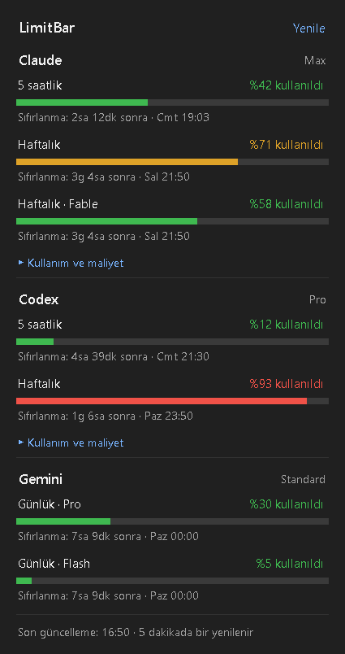

# LimitBar

**A tiny Windows tray app that shows your Claude Code, Codex and Gemini CLI usage limits.**

[Türkçe](README.md)



- 🟢 The tray icon shows your highest usage percentage: green (< 70%), amber (70–90%), red (≥ 90%)
- 🖱️ Left-click: 5-hour / weekly / per-model limits for each service, with progress bars and reset times
- 🔔 Windows notification when any limit reaches **95%** (once per limit period)
- 💰 **Token usage** for Claude Code and Codex (today / 7 days / 30 days) and its **estimated cost at API prices**
- 🔄 Refreshes every 5 minutes, or on demand from the right-click menu
- 🪶 **Nothing to install:** runs on the PowerShell 5.1 and .NET Framework that ship with Windows
- 🔒 Your tokens are only sent to each provider's own servers (Anthropic, OpenAI, Google)

Inspired by [CodexBar](https://github.com/steipete/CodexBar) for macOS.

> The UI is currently in Turkish. "kullanıldı" = used, "Sıfırlanma" = resets, "5 saatlik" = 5-hour, "Haftalık" = weekly, "Günlük" = daily, "Bugün" = today, "Son 7 gün" = last 7 days, "tahmini maliyet" = estimated cost, "M" = million, "Mr" = billion.

<br clear="right">

## Supported services

| Service | Limits shown | Requirement |
|---|---|---|
| **Claude Code** | 5-hour, weekly, per-model weekly limits (e.g. **Fable**), extra usage | Signed in to the `claude` CLI with a Pro / Max / Team / Enterprise plan |
| **Codex** | 5-hour and/or weekly, per-model limits, credit balance | Signed in to Codex (CLI or desktop app) with a ChatGPT account |
| **Gemini CLI** | Daily Pro / Flash / Flash-Lite quota | Signed in to the `gemini` CLI with Google (see [Gemini note](#gemini-note)) |

Services you are not signed in to are simply hidden.

## Install

### One-liner (recommended)

Open PowerShell and paste:

```powershell
irm https://raw.githubusercontent.com/gelistirici-user/LimitBar/main/install.ps1 | iex
```

This downloads `LimitBar.ps1` and `LimitBar.vbs` to `%LOCALAPPDATA%\LimitBar`, adds Start Menu and startup shortcuts, and launches the app. If you don't see the icon next to the clock, click the **^** arrow in the taskbar.

> To skip the startup shortcut, run `$env:LIMITBAR_NO_AUTOSTART = '1'` first, or untick **Windows ile başlat** (start with Windows) in the right-click menu later.

### Manual (zip)

Download the repo as a ZIP, extract it, open PowerShell in that folder and run:

```powershell
Get-ChildItem . -Recurse | Unblock-File
powershell -ExecutionPolicy Bypass -File .\install.ps1
```

Add `-NoAutostart` to skip the startup shortcut.

### Update / uninstall

Re-run the install command to update (the running instance is closed automatically). To uninstall:

```powershell
irm https://raw.githubusercontent.com/gelistirici-user/LimitBar/main/uninstall.ps1 | iex
```

This removes the app folder and shortcuts. Your Claude / Codex / Gemini sessions are not touched.

## Notifications

When any limit (5-hour, weekly, per-model…) reaches **95%**, you get a Windows notification, once per limit period; it re-arms after the limit resets. Toggle it from the right-click menu (**Limit %95 olunca bildir**), or change `"threshold"` in `%LOCALAPPDATA%\LimitBar\settings.json` and restart the app.

## Token usage and estimated cost

Click **▸ Kullanım ve maliyet** (usage and cost) under a service to expand these details; they start collapsed each time the app starts.

For Claude Code and Codex, the panel shows tokens spent **today, in the last 7 days and in the last 30 days**, what that would cost **at API prices**, and the 30-day cost split by model.

- Read from the CLIs' local session logs (`%USERPROFILE%\.claude\projects\**\*.jsonl`, `%USERPROFILE%\.codex\sessions\**\*.jsonl`). **Nothing is sent anywhere.**
- Logs are scanned once at startup (a few seconds for several GB), then only newly appended lines are read.
- Token totals include cache reads and cache writes; the cost prices each kind at its own rate.
- **This is an estimate, not your bill.** On a subscription (Pro / Max / Team / Plus…) you don't pay this amount; it shows what the same usage would cost via the API, using Anthropic's and OpenAI's standard API prices as of November 2026 (long-context, batch and fast-mode pricing is not modelled).

## Command-line options

| Parameter | Description |
|---|---|
| `-Once` | Print limits (`Limits`) and token usage (`Usage`) as JSON without opening the UI |
| `-NoRefresh` | Never refresh expired tokens; never write to credential files |
| `-Demo` | Use sample data instead of real accounts |
| `-Screenshot path.png` | Render the panel to a PNG and exit |

## How it works

LimitBar never signs in by itself. It reads the session the CLI tools already stored on your machine and calls each provider's usage endpoint:

| Service | Credential file | Endpoint |
|---|---|---|
| Claude Code | `%USERPROFILE%\.claude\.credentials.json` (or `%CLAUDE_CONFIG_DIR%`) | `api.anthropic.com/api/oauth/usage` |
| Codex | `%USERPROFILE%\.codex\auth.json` (or `%CODEX_HOME%`) | `chatgpt.com/backend-api/wham/usage` |
| Gemini CLI | `%USERPROFILE%\.gemini\oauth_creds.json` | `cloudcode-pa.googleapis.com` (`loadCodeAssist`, `retrieveUserQuota`) |

**Token refresh:** if a Claude or Codex token has expired, LimitBar refreshes it the same way the CLI does and writes the new token back to the same file, so the CLI keeps working. Use `-NoRefresh` if you don't want that; the CLI will refresh the token itself next time you run it. Gemini tokens are refreshed in memory only.

## Troubleshooting

| Symptom | Fix |
|---|---|
| **401** | Sign in again: `claude` → `/login`, `codex login`, `gemini` |
| **429** | The server is rate-limiting. LimitBar backs off and retries. For Claude, running `claude` once refreshes the token immediately. |
| **No icon** | Check the **^** overflow area. Otherwise start `LimitBar.ps1` directly from PowerShell to see the error. |
| **Antivirus warning** | To hide the console window, the app starts PowerShell hidden via `wscript`, a pattern some antivirus products flag. The full source is in this repo. |
| **Service missing** | You're not signed in to it as this Windows user. CLIs running **inside WSL** keep their credentials on the Linux side, which LimitBar cannot see. |

### Gemini note

Since June 2026 Google no longer supports Gemini CLI OAuth quota queries for personal (Gmail, AI Pro, AI Ultra) accounts. Quota is shown only for **Google Workspace, education and Gemini Code Assist Standard / Enterprise** accounts. The OAuth client used for token refresh is not embedded; it is read from your installed `@google/gemini-cli` package or from the `GEMINI_OAUTH_CLIENT_ID` / `GEMINI_OAUTH_CLIENT_SECRET` environment variables.

## Disclaimer

LimitBar is **unofficial** and not affiliated with Anthropic, OpenAI or Google. It relies on **undocumented** endpoints that may change at any time.

## License

[MIT](LICENSE)
