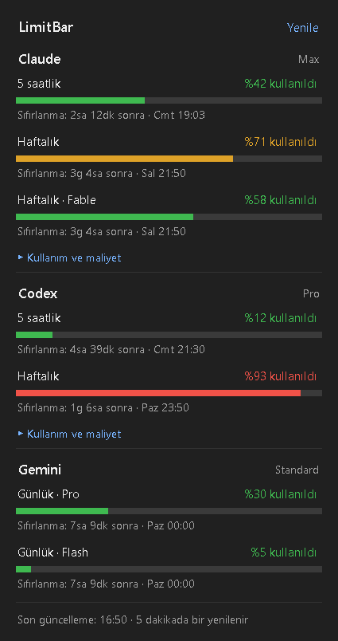

# LimitBar

**Claude Code, Codex ve Gemini CLI kullanım limitlerinizi Windows görev çubuğunda gösteren küçük bir tepsi uygulaması.**

[English](README.en.md)



- 🟢 Tepsi ikonu en yüksek kullanım yüzdenizi gösterir: yeşil (< %70), sarı (%70–90), kırmızı (≥ %90)
- 🖱️ Sol tık: her servis için 5 saatlik / haftalık / model bazlı limitler, ilerleme çubukları ve sıfırlanma zamanları
- 🔔 Bir limit **%95'e** ulaşınca Windows bildirimi gösterir (her limit dönemi için bir kez)
- 💰 Claude Code ve Codex için bugün / 7 gün / 30 günlük **token kullanımı** ve bunun **API fiyatıyla tahmini maliyeti**
- 🔄 5 dakikada bir otomatik yenilenir; sağ tık menüsünden elle de yenilenebilir
- 🪶 **Ek kurulum gerekmez:** Windows'ta hazır gelen PowerShell 5.1 ve .NET Framework ile çalışır
- 🔒 Tokenlarınız sadece ilgili servisin kendi sunucusuna gönderilir (Anthropic, OpenAI, Google)

macOS için yazılmış [CodexBar](https://github.com/steipete/CodexBar) uygulamasından esinlenmiştir.

<br clear="right">

## Desteklenen servisler

| Servis | Gösterilen limitler | Gereken |
|---|---|---|
| **Claude Code** | 5 saatlik, haftalık, model bazlı haftalık limitler (ör. **Fable**), ek kullanım | Claude Pro / Max / Team / Enterprise aboneliğiyle `claude` CLI'a giriş yapılmış olması |
| **Codex** | 5 saatlik ve/veya haftalık, modele özel limitler, kredi bakiyesi | ChatGPT hesabıyla Codex'e (CLI veya masaüstü uygulaması) giriş yapılmış olması |
| **Gemini CLI** | Günlük Pro / Flash / Flash-Lite kotası | Google hesabıyla `gemini` CLI'a giriş yapılmış olması (bkz. [Gemini notu](#gemini-notu)) |

Giriş yapılmamış servisler panelde hiç görünmez.

## Kurulum

### Tek satırla (önerilen)

PowerShell'i açın ve şunu yapıştırın:

```powershell
irm https://raw.githubusercontent.com/gelistirici-user/LimitBar/main/install.ps1 | iex
```

Bu komut:
1. `LimitBar.ps1` ve `LimitBar.vbs` dosyalarını `%LOCALAPPDATA%\LimitBar` klasörüne indirir,
2. Başlat menüsüne ve Windows başlangıcına kısayol ekler,
3. Uygulamayı başlatır.

Birkaç saniye içinde saatin yanında renkli, içinde yüzde yazan bir ikon görünür. Görünmüyorsa görev çubuğundaki **^** okuna tıklayın; ikonu sürükleyip görev çubuğuna sabitleyebilirsiniz.

> Windows ile otomatik başlamasını istemiyorsanız önce `$env:LIMITBAR_NO_AUTOSTART = '1'` çalıştırın, ya da kurduktan sonra sağ tık menüsünden **Windows ile başlat** seçeneğini kapatın.

### Elle (zip ile)

1. Bu sayfada **Code → Download ZIP** ile indirip bir klasöre çıkarın.
2. O klasörde PowerShell açıp dosyaların "internetten indirildi" işaretini kaldırın ve kurun:

```powershell
Get-ChildItem . -Recurse | Unblock-File
powershell -ExecutionPolicy Bypass -File .\install.ps1
```

`-NoAutostart` eklerseniz başlangıç kısayolu oluşturulmaz.

### Güncelleme

Kurulum komutunu tekrar çalıştırmanız yeterli; çalışan eski sürüm otomatik kapatılır.

### Kaldırma

```powershell
irm https://raw.githubusercontent.com/gelistirici-user/LimitBar/main/uninstall.ps1 | iex
```

Uygulamayı kapatır, `%LOCALAPPDATA%\LimitBar` klasörünü ve kısayolları siler. Claude / Codex / Gemini oturumlarınıza dokunmaz.

## Kullanım

| İşlem | Sonuç |
|---|---|
| İkona **sol tık** | Limit panelini açar / kapatır |
| Paneldeki **▸ Kullanım ve maliyet** | O servisin token / maliyet ayrıntılarını açar / kapatır (uygulama her açıldığında kapalı başlar) |
| İkonun **üzerine gelmek** | Her servisin en yüksek kullanımını kısaca gösterir |
| **Sağ tık → Şimdi yenile** | Limitleri hemen yeniden çeker |
| **Sağ tık → Windows ile başlat** | Başlangıçta açılmayı açar / kapatır |
| **Sağ tık → Limit %95 olunca bildir** | Bildirimleri açar / kapatır |
| **Sağ tık → Çıkış** | Uygulamayı kapatır |

### Bildirimler

Herhangi bir limit (5 saatlik, haftalık, model bazlı…) **%95'e** ulaştığında Windows bildirimi gelir. Aynı limit dönemi için yalnızca bir kez bildirilir; limit sıfırlanıp tekrar %95'i geçerse yeniden bildirilir. Eşiği değiştirmek için `%LOCALAPPDATA%\LimitBar\settings.json` dosyasındaki `"threshold"` değerini düzenleyip uygulamayı yeniden başlatın.

### Token kullanımı ve tahmini maliyet

Panelde Claude Code ve Codex için **bugün, son 7 gün ve son 30 gün** harcanan token miktarı ile bunun **API fiyatlarıyla ne kadar tutacağı** gösterilir; altında 30 günlük maliyetin modellere göre dağılımı yer alır.

- Veriler CLI araçlarının bilgisayarınızdaki oturum kayıtlarından okunur (`%USERPROFILE%\.claude\projects\**\*.jsonl`, `%USERPROFILE%\.codex\sessions\**\*.jsonl`). **Hiçbir yere gönderilmez.**
- Kayıtlar ilk açılışta bir kez taranır (birkaç GB'lık kayıt için birkaç saniye), sonraki yenilemelerde yalnızca yeni eklenen satırlar okunur.
- Token toplamına önbellekten okunan (cache read) ve önbelleğe yazılan tokenlar da dahildir; maliyet her türü kendi fiyatıyla hesaplar.
- **Bu bir tahmindir ve faturanız değildir.** Abonelikle (Pro / Max / Team / Plus…) kullandığınızda bu tutarı ödemezsiniz; aynı kullanımın API ile kaç dolara geleceğini gösterir. Fiyatlar 2026 Kasım itibarıyla Anthropic ve OpenAI'ın standart API fiyatlarıdır (uzun bağlam, batch ve hızlı mod indirim/ek ücretleri hesaba katılmaz).

### Komut satırı seçenekleri

```powershell
# Limitleri ve token kullanımını bir kez çekip JSON olarak yazdırır (betiklerde kullanmak için)
powershell -ExecutionPolicy Bypass -File "$env:LOCALAPPDATA\LimitBar\LimitBar.ps1" -Once
```

| Parametre | Açıklama |
|---|---|
| `-Once` | Arayüz açmadan limitleri (`Limits`) ve token kullanımını (`Usage`) JSON olarak yazdırır |
| `-NoRefresh` | Süresi dolmuş tokenları yenilemez; kimlik dosyalarına hiç yazmaz |
| `-Demo` | Gerçek hesaplar yerine örnek verilerle çalışır |
| `-Screenshot yol.png` | Paneli PNG olarak kaydedip çıkar |

## Nasıl çalışır?

LimitBar kendi başına giriş yapmaz. CLI araçlarının bilgisayarınıza kaydettiği oturum bilgilerini okur ve her servisin kendi limit sorgusunu yapar:

| Servis | Okunan dosya | Sorgulanan adres |
|---|---|---|
| Claude Code | `%USERPROFILE%\.claude\.credentials.json` (veya `%CLAUDE_CONFIG_DIR%`) | `api.anthropic.com/api/oauth/usage` |
| Codex | `%USERPROFILE%\.codex\auth.json` (veya `%CODEX_HOME%`) | `chatgpt.com/backend-api/wham/usage` |
| Gemini CLI | `%USERPROFILE%\.gemini\oauth_creds.json` | `cloudcode-pa.googleapis.com` (`loadCodeAssist`, `retrieveUserQuota`) |

**Token yenileme:** Claude veya Codex tokenının süresi dolmuşsa LimitBar, CLI'ın kendisinin yaptığı gibi tokenı yeniler ve yenisini aynı dosyaya geri yazar; böylece CLI çalışmaya devam eder. Bunu istemiyorsanız `-NoRefresh` kullanın: süresi dolan token için panel uyarı gösterir, siz `claude` / `codex` çalıştırınca CLI tokenı kendisi yeniler. Gemini tokenı yalnızca bellekte yenilenir, dosyaya yazılmaz.

Arka planda tamamen PowerShell + WinForms kullanılır; ağ istekleri arayüzü dondurmamak için ayrı bir runspace'te yapılır.

## Sorun giderme

| Belirti | Çözüm |
|---|---|
| **"Yetki reddedildi (401)"** | İlgili CLI'da yeniden giriş yapın: `claude` → `/login`, `codex login`, `gemini` |
| **"Çok fazla istek (429)"** | Sunucu geçici olarak reddediyor. LimitBar bekleyip kendisi tekrar dener. Claude tokenı için bir terminalde `claude` çalıştırmak tokenı hemen yeniler. |
| **İkon hiç görünmüyor** | Görev çubuğundaki **^** okuna bakın. Hâlâ yoksa `powershell -ExecutionPolicy Bypass -File "$env:LOCALAPPDATA\LimitBar\LimitBar.ps1"` ile başlatıp hata mesajını okuyun. |
| **Antivirüs uyarısı** | Uygulama, konsol penceresi göstermemek için `wscript` ile gizli bir PowerShell başlatır; bazı antivirüsler bu kalıbı şüpheli bulabilir. Kaynak kodun tamamı bu repodadır, inceleyebilirsiniz. |
| **"running scripts is disabled"** | Kurulumu yukarıdaki komutlarla (`-ExecutionPolicy Bypass`) yapın. Şirket bilgisayarlarında grup ilkesi betikleri tamamen engelliyorsa BT ekibinize danışın. |
| **Servis panelde yok** | O servise bu Windows kullanıcısıyla giriş yapılmamış. CLI'ı **WSL içinde** kullanıyorsanız oturum dosyaları Linux tarafındadır ve LimitBar onları göremez. |

### Gemini notu

Google, Haziran 2026'dan itibaren kişisel (Gmail, AI Pro, AI Ultra) hesaplarda Gemini CLI'ın kota bilgisini OAuth ile sorgulamayı desteklemiyor. Kota yalnızca **Google Workspace, eğitim ve Gemini Code Assist Standard / Enterprise** hesaplarında görünür; diğer hesaplarda panel bunu açıklayan bir mesaj gösterir.

Tokenı yenilemek için gereken OAuth istemci bilgisi koda gömülü değildir; bilgisayarda kurulu `@google/gemini-cli` paketinden okunur ya da `GEMINI_OAUTH_CLIENT_ID` / `GEMINI_OAUTH_CLIENT_SECRET` ortam değişkenleriyle verilebilir.

## Gereksinimler

- Windows 10 veya 11
- Windows PowerShell 5.1 (Windows ile birlikte gelir)
- İzlemek istediğiniz CLI araçlarına bu bilgisayarda giriş yapılmış olması

## Önemli uyarılar

- LimitBar **resmî değildir**; Anthropic, OpenAI veya Google ile bir bağlantısı yoktur.
- Limitler, CLI araçlarının kendi kullandığı ama **belgelenmemiş** adreslerden okunur. Servisler bu adresleri değiştirirse LimitBar'ın da güncellenmesi gerekir.
- Arayüz şimdilik yalnızca Türkçedir.

## Katkı

Hata bildirimleri ve pull request'ler memnuniyetle karşılanır. Yeni bir servis eklemek için `LimitBar.ps1` içindeki `Get-Claude` / `Get-Codex` / `Get-Gemini` fonksiyonlarına benzer bir fonksiyon yazıp sonuç listesine eklemeniz yeterli. Değişiklikleri gerçek hesaplara dokunmadan `-Demo` ve `-Screenshot` ile deneyebilirsiniz.

## Lisans

[MIT](LICENSE)
